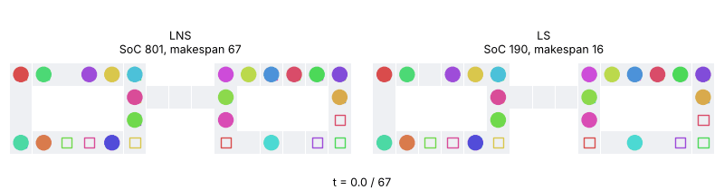

# Dynamic programming-based local search for MAPF

[](https://doi.org/10.5281/zenodo.24115532)
<!-- replace XXXXXXX with the Zenodo record after the first release (docs/RELEASING.md) -->

Code and benchmark of the paper *Dynamic Programming-Based Local Search for
MAPF on Directed Graphs* (S. Ardizzoni, L. Consolini, M. Locatelli,
I. Saccani, Dipartimento di Ingegneria e Architettura, Università di Parma).

The local search improves a given multi-agent plan by searching, exactly, the
best plan within a neighbourhood of it: a dynamic program over a
sequentialized automaton (one agent decides at a time), with a goal-directed
A* variant, on directed or undirected graphs. The repository contains

- the local search in C++ (`cpp/dpls.cpp`): pointwise, path, route-lag,
  grouped-clock, agent and free-set neighbourhoods, order-based neighbourhoods
  (retiming, order swaps), variable neighbourhood descent with adaptive radii,
  chaining of forced moves, beam search with a bounded open list, optional
  parallel search of free-set candidates;
- a Python package (`mapf_bench/`) with instance generators, MAPF-LNS (a
  re-implementation for directed graphs and an adapter for the official code),
  adapters for LaCAM3 and PIBT, the methods compared in the paper, a parallel
  local runner, analysis and statistics, an automatic update of the paper's
  tables and numbers, a web dashboard and plan animations;
- the benchmark protocol of the paper (`configs/paper.json`) and the tests.

## Requirements

- Python ≥ 3.10 with `numpy`, `scipy`, `matplotlib`, `pytest`
  (`pip install -r requirements.txt`);
- a C++17 compiler (g++ or clang++);
- optional, for the comparisons on grids: [LaCAM3](https://github.com/kei18/lacam3)
  and the official [MAPF-LNS](https://github.com/Jiaoyang-Li/MAPF-LNS) (with
  the patch in `patches/`), built by the scripts below (CMake, Boost, Eigen).

## Build and test

```bash
python -m venv .venv && source .venv/bin/activate
pip install -r requirements.txt
scripts/build_cpp.sh              # the local search (cpp/dpls)
scripts/build_lacam.sh            # optional: LaCAM3 in third_party/
scripts/build_official_lns.sh     # optional: official MAPF-LNS in third_party/ (patched)
python -m pytest -q               # tests needing LaCAM3 or MAPF-LNS are skipped if not built
```

`scripts/setup_local.sh` does all of the above. The binaries can also be given
by the environment variables `DPLS_BIN`, `LACAM_BIN` and `MAPF_LNS_BIN`. A
`Dockerfile` builds a complete environment.

## Reproducing the experiments

```bash
# quick check (a few instances)
python -m mapf_bench.local_runner run configs/smoke.json --workers 2

# numerical check: one instance per group, all the methods, 5 s each (about 6 minutes)
python -m mapf_bench.local_runner run configs/numerical_check.json --workers 2

# benchmark of the paper: every method with the same budget (20 s, one thread)
python -m mapf_bench.local_runner run configs/paper.json --workers 5 \
    --update-paper path/to/paper.tex --compile
python -m mapf_bench.local_runner errors results/paper      # jobs that failed
python -m mapf_bench.local_runner dashboard results/        # http://127.0.0.1:8765
```

The runner resumes an interrupted run, reruns failed jobs with
`--retry-errors`, and runs only the methods or instances added to the
configuration. `--update-paper` rewrites the tables and the macros of the
paper (`bench_numbers.tex`) and checks its qualitative claims against the
results (`paper_update/report.md`). Every job is single-threaded; use at most
as many workers as performance cores, since the methods have a time budget.

Other configurations: `configs/deadlock.json`, `corridors.json`,
`reduced.json`, `pibt.json`, `dense.json`, `movingai_official.json`.

### Results of the paper

`paper_results/` contains the run reported in the paper (509 jobs, 20 s per
method): the results of every instance and method, the tables, the performance
profiles and the check of the paper's claims. The tables and numbers of a paper
can be regenerated from them without rerunning the benchmark:

```bash
python -m mapf_bench.paper_update paper_results --paper path/to/paper.tex
```

### Animations



Two rings on a grid joined by a corridor: 20 agents, most of which rotate along
their ring while four cross to the other ring in both directions. From a
serialized plan of prioritized planning (one agent moves at a time, Sum-of-Costs
2706, makespan 187), MAPF-LNS reaches 801 and makespan 67 in 10 s (left), and
the local search 190 and makespan 16 (right): it moves the agents together and
lets them cross the corridor in the right order. The interactive versions, with
the initial plan, play/pause, a time slider and the arrival time of every agent,
are on the site of the repository (GitHub Pages, see `docs/RELEASING.md`):
https://&lt;user&gt;.github.io/mapf-dp-local-search/. They are generated by
`scripts/make_animations.py`.

The runner saves the plans of every job, and `mapf_bench.visualize` animates
them:

```bash
python -m mapf_bench.visualize results/paper --list                # jobs with saved plans
python -m mapf_bench.visualize results/paper --job paper:5 \
    --methods initial LNS LS --out rings.html --gif rings.gif
python -m mapf_bench.visualize results/paper --all                 # one page per job + index.html
```

### Instance groups (`mapf_bench/paper_suite.py`)

| Group | Instances |
|---|---|
| S | structured: fully occupied rings, rings on grids, convoys |
| D | random strongly connected digraphs and one-way grids |
| M | MovingAI maps, 20-40 agents |
| H | small MovingAI maps at 80-98% occupancy |
| W | dense 4x5 grids |
| L | MovingAI maps with reduced connectivity |
| K | deadlock-prone grids (corridor swaps, dead ends, order reversal, crossroads) |
| C | grids of width-1 corridors (warehouse, city blocks, braided maze) at 50-98% occupancy |
| P | instances of M, H, W, L, K with PIBT initial plans |

### Methods (`paper_suite.run_method`)

`LNS`, `LaCAM*`, `LS` (local search), `Hybrid` (LNS phases and local search),
`LNS+LS`, `LaCAM*+Hybrid`, `LaCAM*+LNS`, `LSB` (local search with beam
escapes from certified local optima), `LNS+LSB`, `LaCAM*+LNS+LSB`, `LSBX` (LSB
with free sets chosen by LNS destroy heuristics and replanned jointly), and,
outside the default list, `LSX`, `LNS+LSX`, `LaCAM*+LNS+LSBX`.

## Repository structure

```
cpp/dpls.cpp          local search (C++)
mapf_bench/           Python package (instances, methods, runner, analysis, paper update)
configs/              benchmark configurations
scripts/              build scripts, speed benchmarks of the C++ search
patches/              patch of the official MAPF-LNS (initial paths, output, seed, stagnation)
benchmarks/movingai/  MovingAI maps and scenarios used
paper_results/        results of the run reported in the paper
tests/                tests (pytest)
docs/NOTES.md         detailed notes on the implementation and the experiments
docs/RELEASING.md     how to publish a release on GitHub and Zenodo
```

## Third-party code and data

LaCAM3 (K. Okumura) and MAPF-LNS (J. Li et al.) are downloaded and built by the
scripts into `third_party/`; they are not part of this repository and keep
their own licenses. The MovingAI maps are from the MovingAI MAPF benchmark
(N. Sturtevant; R. Stern et al.), see `benchmarks/movingai/README.md`.

## Use of AI tools

The code of this repository (the C++ local search, the Python package, the
benchmark protocol, the scripts and the tests) was generated with Claude, an AI
assistant developed by Anthropic, under the direction of the authors, who
designed the method and the experiments, reviewed the code, and are responsible
for it. Its correctness is checked by the test suite and, in every experiment,
by validating every returned plan (no collisions, every agent at its goal);
the claims of the paper are checked automatically against the results
(`paper_results/claims_report.md`).

## Citing

If you use this code, please cite the paper and the archived release on Zenodo
for the version you used (see `CITATION.cff`; GitHub shows it under "Cite this
repository"). Each release is archived on Zenodo with its own DOI; see
`docs/RELEASING.md`.

## License

Copyright (C) 2026 S. Ardizzoni, L. Consolini, M. Locatelli, I. Saccani.

This program is free software: you can redistribute it and/or modify it under
the terms of the GNU General Public License as published by the Free Software
Foundation, either version 3 of the License, or (at your option) any later
version (see `LICENSE`). It is distributed in the hope that it will be useful,
but WITHOUT ANY WARRANTY; without even the implied warranty of MERCHANTABILITY
or FITNESS FOR A PARTICULAR PURPOSE. See the GNU General Public License for
more details.

Exception: `patches/mapf-lns-initpaths.patch` contains parts of MAPF-LNS and is
distributed under the MAPF-LNS license (University of Southern California;
educational, research and non-profit use), see `patches/README.md`. LaCAM3 and
MAPF-LNS themselves are not included; the build scripts download them, and
they keep their own licenses (MIT and the USC license).
